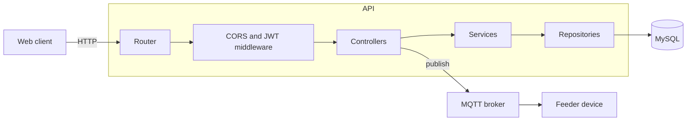

# Feeder Backend

REST API for an IoT pet feeder, written in Go. It registers users and feeder devices in MySQL, and talks to the physical feeder over MQTT to trigger the motor that dispenses food.

The web client lives in [feeder-frontend](https://github.com/Yisuslalala/feeder-frontend).

## Tech stack

- Go 1.24 with [Gorilla Mux](https://github.com/gorilla/mux) for routing
- MySQL through `database/sql` and `go-sql-driver/mysql`
- MQTT through [Eclipse Paho](https://github.com/eclipse/paho.mqtt.golang)
- JWT (HS256) for authentication and bcrypt for password hashing
- Configuration from environment variables, with `.env` support for local development

## Architecture

The code follows a layered design. Each layer depends only on the one below it, through an interface, and everything is wired by hand in `main.go`.



| Layer | Package | Responsibility |
| --- | --- | --- |
| Routing | `internal/routers` | Maps HTTP routes to controllers |
| Middleware | `internal/middleware` | CORS and JWT validation |
| Controllers | `internal/controllers` | Decode requests, call services, write JSON responses |
| Services | `internal/services` | Business rules and validation |
| Repositories | `internal/repositories` | SQL access behind interfaces |
| Models | `internal/models` | Domain structs |
| Infrastructure | `internal/db`, `internal/mqtt`, `internal/config` | Database connection, MQTT client and configuration |

## Data model

The schema is in [`sql/database.sql`](sql/database.sql).

- `users`: accounts with a unique email and a bcrypt password hash
- `houses`: a household owned by one user
- `house_users`: membership of users in a house, with the role `owner`, `admin` or `member`
- `feeders`: a device that belongs to a house, identified by a unique MAC address
- `feeder_details`: the log of feedings, one row per time the feeder was triggered

## API

Every response uses the same envelope:

```json
{ "success": true, "data": {}, "error": "" }
```

| Method | Path | Body | Result |
| --- | --- | --- | --- |
| `POST` | `/api/auth/register` | `email`, `password` | Creates a user and returns it with a JWT |
| `POST` | `/api/auth/login` | `email`, `password` | Returns the user with a JWT that expires in 24 hours |
| `POST` | `/feeders` | `house_id`, `mac_address`, `name`, `pet_type` | Registers a feeder device in a house |

Protected routes go under `/api/user` and require the header `Authorization: Bearer <token>`.

## Running locally

You need Go 1.24 or later, a MySQL server and an MQTT broker such as [Mosquitto](https://mosquitto.org/). The server exits at startup if it cannot reach the database or the broker.

1. Create the database and load the schema:

   ```bash
   mysql -u root -p -e "CREATE DATABASE feeder"
   mysql -u root -p feeder < sql/database.sql
   ```

2. Create a `.env` file in the project root:

   ```env
   DB_USER=root
   DB_PASS=your_password
   DB_HOST=localhost
   DB_PORT=3306
   DB_NAME=feeder
   MQTT_HOST=localhost
   MQTT_PORT=1883
   MQTT_CLIENT_ID=feeder-backend
   SERVER_PORT=8000
   CLIENT_ORIGIN=localhost
   CLIENT_PORT=5173
   JWT_SECRET=replace_with_a_secret_of_at_least_32_characters
   ```

3. Start the server:

   ```bash
   go run .
   ```

`JWT_SECRET` must be at least 32 characters long.

## Deployment

The API is deployed on [Render](https://render.com/), with the MySQL database hosted on AWS. In production the same variables are set in the environment instead of a `.env` file.

## Status

This is a personal project under active development. It started as a single-feeder prototype and is being migrated to a multi-user model with houses and several feeders per house.

- Done: layered architecture, configuration, MySQL and MQTT connections, user registration and login, feeder registration, JWT middleware
- In progress: moving the feeding endpoints (`/details`) and the MQTT motor command into the new service and repository layers, and protecting feeder routes with JWT
- Planned: house management endpoints, feeding schedules, device status reported back over MQTT
